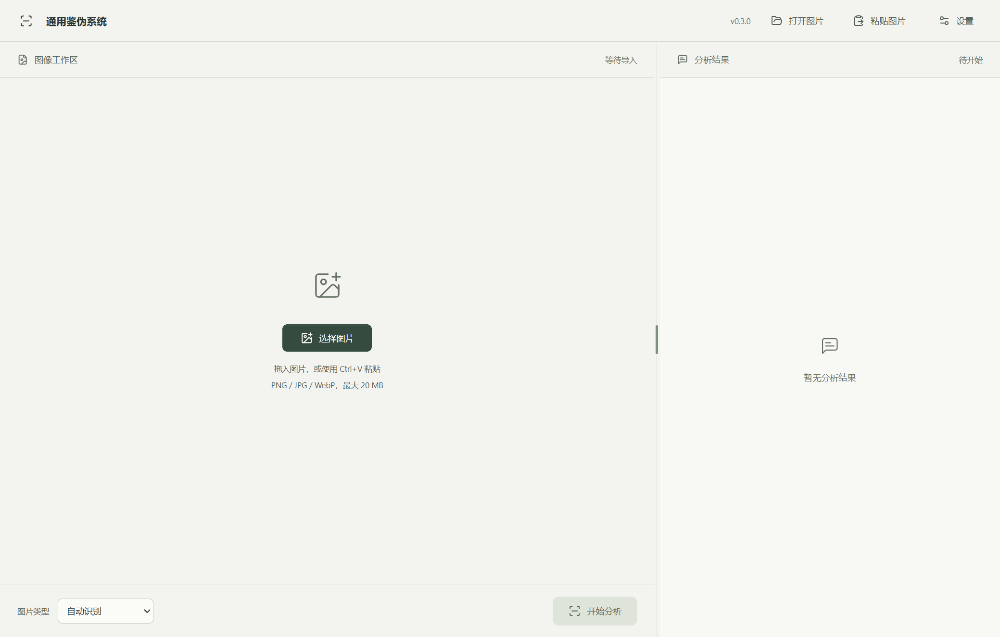

# 通用鉴伪系统

基于本地推理的 Windows 图像鉴伪桌面应用。系统连接来源检查、视觉检测、局部定位和自然语言说明，支持从结论回到原图核查证据。

**v0.3.0 · Windows x64 · Electron / React / TypeScript / Python**

[下载最新版](https://github.com/Pocon041/image-authenticity-app/releases/latest) · [安装说明](docs/INSTALLATION.md) · [开发配置](docs/DEVELOPMENT.md) · [报告协议](docs/REPORT_PROTOCOL_V1.md)



## 下载安装

项目提供两种安装方式。

### 完整版

适合直接使用检测、定位和本地解释功能的用户。安装资源包含三个 Python 环境、SICA、RITA、RiSE、FSD 的默认检测资源、来源检查依赖，以及 Ollama 和 Qwen3-VL-2B 解释模型。

下载完整安装器与全部六个数据分卷，放在同一文件夹，然后运行安装器。程序会自动校验并准备离线资源、启动应用安装向导。首次打开后选择模型与报告目录，等待自动配置完成即可使用。

[完整安装器](https://github.com/Pocon041/image-authenticity-app/releases/download/v0.3.0/SRDP-Full-Setup-0.3.0-x64.exe) · [数据01](https://github.com/Pocon041/image-authenticity-app/releases/download/v0.3.0/SRDP-Full-Data-0.3.0-01.bin) · [数据02](https://github.com/Pocon041/image-authenticity-app/releases/download/v0.3.0/SRDP-Full-Data-0.3.0-02.bin) · [数据03](https://github.com/Pocon041/image-authenticity-app/releases/download/v0.3.0/SRDP-Full-Data-0.3.0-03.bin) · [数据04](https://github.com/Pocon041/image-authenticity-app/releases/download/v0.3.0/SRDP-Full-Data-0.3.0-04.bin) · [数据05](https://github.com/Pocon041/image-authenticity-app/releases/download/v0.3.0/SRDP-Full-Data-0.3.0-05.bin) · [数据06](https://github.com/Pocon041/image-authenticity-app/releases/download/v0.3.0/SRDP-Full-Data-0.3.0-06.bin)

完整下载约10.4GB。数据分卷由安装器自动读取，用户无需手动解压，也无需另外下载 Python、模型权重或 Ollama。分卷用于满足 GitHub 单附件小于2GiB的限制。安装器与资源文件的目录结构见[安装说明](docs/INSTALLATION.md#完整版)。

### 开发者版

适合自行配置模型、调整工作流或扩展适配器的开发者。约130MB，提供桌面框架、交互工作台、模拟流程、报告协议和本项目后端适配脚本。

运行安装器后，可在“设置 → 开发与单模型调试”中选择“模拟流程”体验框架。接入真实模型时，按开发文档自行准备 Python 环境、上游模型源码、权重和解释服务，再选择对应的运行目录。

[开发者版安装器](https://github.com/Pocon041/image-authenticity-app/releases/download/v0.3.0/SRDP-Developer-Setup-0.3.0-x64.exe) · [模型配置与接入](docs/DEVELOPMENT.md)

发布页同时提供 [SHA-256 校验清单](https://github.com/Pocon041/image-authenticity-app/releases/download/v0.3.0/SHA256SUMS.txt)。当前安装器未配置代码签名证书，Windows可能显示未知发布者。

## 可以做什么

- **来源与处理记录**。读取 EXIF、XMP、IPTC 和 C2PA，检查支持的可见文字水印与隐形水印载荷。
- **视觉取证**。FSD 检查 AI 生成线索，SICA 提供通用整图筛查，RITA 与 RiSE 分别负责照片和文档的局部定位。
- **证据解释**。组织来源、整图反馈、局部区域及证据关系，结合原图与裁剪生成自然语言说明。
- **图像核查**。支持拖拽、粘贴、原图与定位切换、滚轮缩放、拖动平移、放大预览，以及可调节的图像／报告分栏。
- **结果留存**。显示实际分析进度，支持取消、重试和部分失败处理，保存简明报告、完整证据包及模型原始输出。

## 使用流程

1. 选择、拖入或粘贴一张图片。
2. 使用“自动识别”，或手动选择普通照片、文档等类型，点击“开始分析”。
3. 查看来源检查、检测和定位进度，阅读综合判断与分析说明。
4. 在说明区切换原图和定位图，缩放查看细节；展开“检测详情与报告”核查原始记录。

当前支持 PNG、JPG、JPEG 和 WebP，每次处理一张图片，最大20MB、6000万像素。RiSE 默认最多处理128个图块。默认检测路径按序使用GPU，单项失败会保留已完成结果。SICA未报警时仍继续定位，FSD阴性与传统编辑线索分别记录。

## 系统要求

- **系统**。Windows 10/11 x64，建议使用已更新的系统。
- **内存**。建议16GB以上，完整检测与本地解释推荐32GB。
- **显卡**。推荐 NVIDIA GPU，8GB或更多显存，驱动需兼容随包 PyTorch CUDA12.6。已在 RTX4060 Laptop 8GB 上完成工程联调。
- **存储**。建议SSD。运行目录预留至少25GB；完整安装资源和运行数据放在同一磁盘时，建议预留50GB。
- **离线使用**。完整版资源准备完成后，默认检测与本地解释流程可离线运行。GPU驱动由系统环境提供。

无可用CUDA时可使用CPU，CPU端到端速度与其他硬件组合尚未系统评测。安装位置、离线资源与运行数据可分开管理，升级和卸载应用会保留独立的数据目录。

## 从源码开发

需要 Git 和 Node.js 22.12+，推荐使用 Node.js 24 LTS。

```powershell
git clone --branch main https://github.com/Pocon041/image-authenticity-app.git
cd image-authenticity-app
.\run.cmd ci
.\start.cmd
```

准备真实模型环境和本机配置的步骤见[开发文档](docs/DEVELOPMENT.md)。权重、运行环境、测试图片、报告和 `*.local.json` 保存在本地。

常用验证入口如下。

```powershell
.\run.cmd run build
.\run.cmd run test:workflow
.\run.cmd run test:protocol
.\run.cmd run test:workbench
.\run.cmd run smoke
```

构建安装器和两种发布产物。

```powershell
.\run.cmd run package:win
.\run.cmd run package:distributions
```

发布产物位于 `dist/v<版本>/release/`。完整版构建需使用已准备、通过校验的运行资源，详见[构建说明](docs/INSTALLATION.md#构建两种安装包)。

## 报告与接口

每次联合分析保存到运行目录的 `work/analysis-runs/<taskId>/`。

```text
analysis.json             简明检测报告
bundle.json               完整证据包与附件索引
reports/provenance.json   来源记录与水印检查
reports/explanation.json  自然语言说明与调用记录
detectors/                模型报告、掩码、响应图与区域裁剪
images/                   原始文件副本与规范显示图
```

原始文件按字节保留，公共 `imageId` 由原文件 SHA-256 生成。定位坐标以 EXIF 方向校正、sRGB、未缩放的显示图为基准。公共字段、状态和证据引用见[报告协议](docs/REPORT_PROTOCOL_V1.md)。

## 项目结构

```text
src/main/       桌面主进程、任务编排、模型适配与证据汇总
src/preload/    受控的类型化IPC桥接
src/renderer/   桌面工作台、图像交互与结果展示
src/shared/     共享类型与报告协议
backend/        Python检测、定位与来源检查
config/         示例配置与本机配置入口
schemas/        JSON Schema
scripts/        环境准备、校验与安装包构建
tests/          协议、工作流与桌面回归检查
```

`main` 维护共享版本。协作约定见 [AGENT.md](AGENT.md)，产品和界面原则分别记录在 [PRODUCT.md](PRODUCT.md) 与 [DESIGN.md](DESIGN.md)。

## 模型与许可

本项目代码采用 [MIT License](LICENSE)。第三方模型、代码和运行组件适用各自条款，完整版面向非商业研究使用，来源与许可说明见[第三方组件与模型](docs/THIRD_PARTY_COMPONENTS.md)。

项目侧重现有模型的工程集成与证据协同。检测可能出现漏报、误报，解释需结合原图核查，当前分数未经统一校准。工程回归记录和模型效果评测分别维护。
