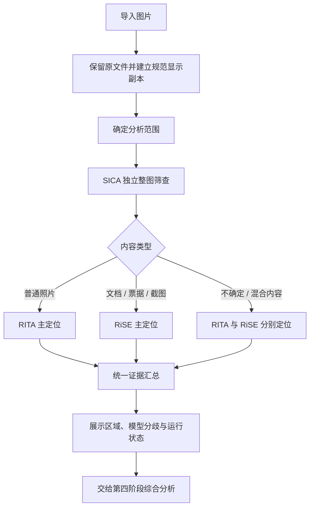

# 篡改检测统一工作流方案

2026-10-28。状态：联合入口已在v0.2.0实现，使用方法及简明JSON说明见 [WORKFLOW_V02.md](./WORKFLOW_V02.md)。HiFi-Net不进入推荐主流程。OCR、文字逻辑核对及最终VLM综合判断由第四阶段负责。下文保留工作流设计依据。

## 模型职责

- SICA：整图通用伪造筛查。保留原始fake/real分数、阈值、权重版本和适用范围。fake不等于局部篡改，real也不作为跳过定位的条件；全图生成由第三人独立检测。
- RITA：普通自然图像的主要定位器。目前本地CASIA定位结果较好，但真实图误标明显，不把高像素响应当作整图真假概率。
- RiSE-9 RGB：文档、票据及截图的主要定位器。采用已接入的原分辨率分块；两张用户样例命中并不证明对所有文档优于RITA，额外标记与擦除泛化仍需验证。
- HiFi-Net：退出推荐主流程。后续实现时从普通用户的分析选择中移除；历史代码、权重和评测先保留，不作为本轮文件清理任务。

## 单次任务流程

图中的执行先后仅用于控制显存。SICA的输出不决定是否进入定位；SICA失败时，在环境允许的情况下继续独立定位，报告该阶段失败。多个GPU模型按顺序加载和释放，避免8GB显存下的并发争抢。

## 路由初版

普通用户只看到「开始分析」，以及可选的内容类型：普通照片、文档/票据/截图、不确定。默认不确定。这里描述的是内容，不依赖扩展名；拍摄的小票属于文档，PNG也可能是普通照片。

第一阶段不新增VLM或未经验证的自动域分类器。普通照片运行SICA+RITA；文档运行SICA+RiSE；不确定运行SICA+RITA+RiSE，RITA/RiSE结果分别保存。默认不确定更慢，但完整性更好。类型选择是效率提示，允许用户改选并重新分析。

可提供一次「补充定位」操作：已按类型执行的任务，再运行另一定位器，生成新的证据快照并关联先前结果。初版不根据SICA低分、高分或定位置信度自动提前结束，也不把像素响应高视为无需进一步分析的依据。

今后若加入自动路由，先以独立的跨来源验证集比较漏检、误报、耗时，再冻结规则；不根据两张样例反复选择阈值或路由。

## 输出与分歧

APP分别展示整图筛查与局部定位。存在区域时可显示「模型标记了可疑区域」，缺少校准依据时不显示篡改概率或真实性总分。SICA与定位器输出的标签含义不同，分歧是需要复核的信息，不是自动判定谁正确。

- SICA fake、定位有区域：展示区域和独立的整图可疑筛查；不声称SICA证明了该具体区域。
- SICA real、定位有区域：保留定位并标注整图筛查与局部响应不一致，不丢弃区域。
- SICA fake、定位无区域：显示整图可疑但尚未定位；可能涉及全图生成或局部定位漏检，交给后续证据分析。
- SICA real、定位无区域：显示本轮未检出，不作为真实性证明。
- 任一模型失败：保留其他模型的完成结果，明确哪项失败。与正常的「未标记区域」区分。

RITA与RiSE输出不进行分数平均或掩码并集。对同时运行的情况，主视图按选定内容类型展示对应模型；另一结果可切换查看。不确定类型需显式保留两种结果，不能依据面积或最大响应偷偷选择“更可信”的模型。

区域重叠可记录为「两模型在该处均有响应」，并保留来源；相同区域的两次响应不冒充两份独立事实。小区域不直接删除，先保留完整掩码，界面可按面积排序并限制裁剪展示数量。具体过滤规则另行验证。

## 第四阶段接收什么

对外提供一个统一的manipulation模块报告及其图片附件；内部保留各模型原始报告以便追溯。模块producer为工作流版本，result增加各检测器的独立状态、分数、区域与模型版本；evidence中的data明确模型来源及原始报告身份。

沿用现有schemaVersion、imageId、taskId、regionId、evidenceId与附件规则。未定义校准融合前，顶层score可以为null，图像级decision保留inconclusive。界面中的「发现可疑区域」属于定位展示状态，与图像级判断分开。

每个区域需包含：规范显示坐标bbox、掩码引用、原图裁剪、模型来源和限制。进一步保存多模型区域对应关系、运行失败、未执行原因。原始模型分数不改名为融合置信度，专家编号不改名为篡改手法。

公共证据包使用单一任务根目录，汇总时将附件URI改写为相对该根目录的路径，核对哈希并去重公共原图/显示副本。不得直接拼接各独立任务bundle，避免附件路径错误或同ID对应不同记录。原始报告的内部追溯ID不写成无法解析的inputReportIds。

第四人接收规范显示图、候选裁剪、各模型掩码、结构化证据和分歧，在最后阶段引入OCR及VLM。最终解释不能把模型疑点改写成已证实的编辑手法；来源与AIGC模块的证据独立进入该阶段。

## 建议实施顺序

1. 新增统一任务编排服务：共享输入快照、模型注册、串行GPU调度、分步进度、取消与部分失败。
2. 新增证据汇总器：模型原始报告保留，生成单一manipulation报告，重写附件相对路径、核对引用及坐标。
3. 调整用户界面：默认一个分析入口、内容类型选择、分开的整图筛查与定位结果、模型分歧提示；独立模型入口归入开发调试。
4. 增加联合Smoke：三种路由、SICA阴性仍执行定位、部分失败、取消、附件引用与原图不变、切换定位来源；随后做带真实未修改图和多种篡改的独立质量验证。

验收以找回漏检同时控制新增误标为目标，不以“结果更红”或生成一个总分为成功标准。
